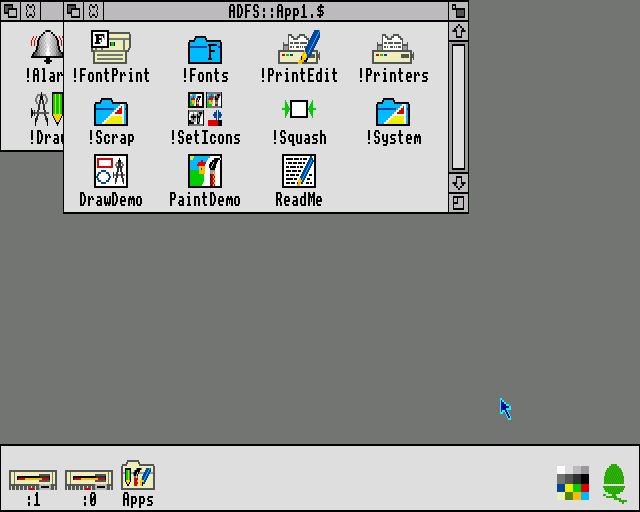
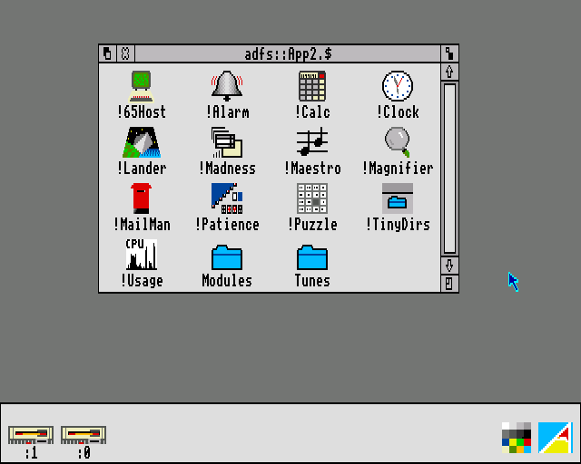
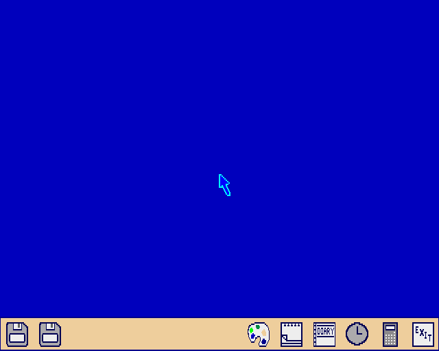
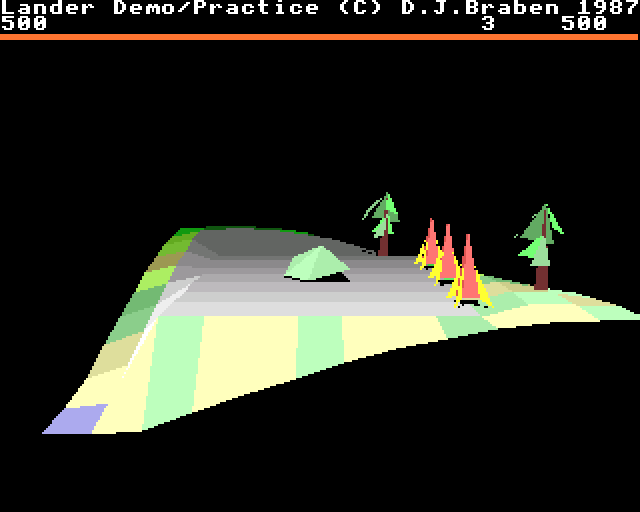
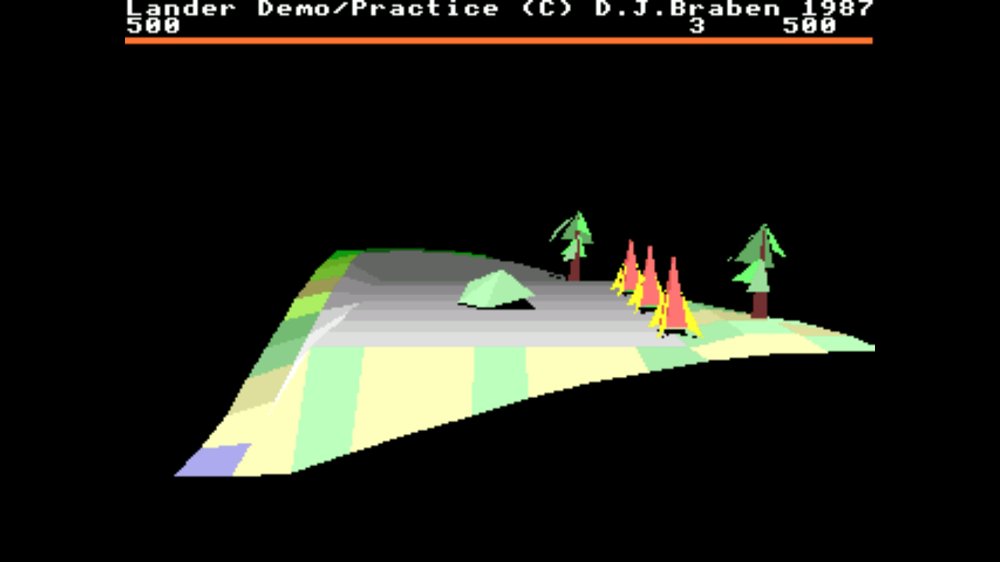
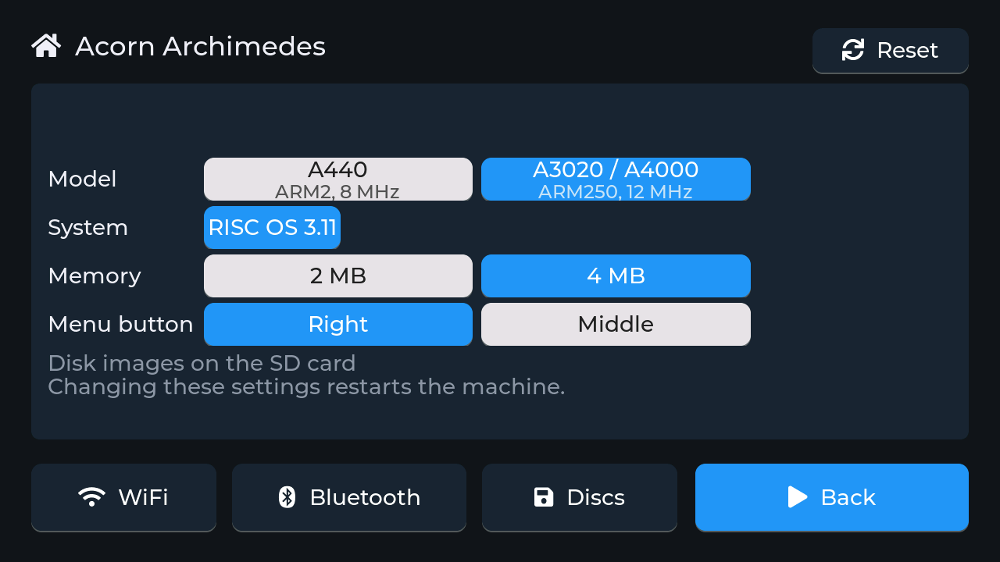
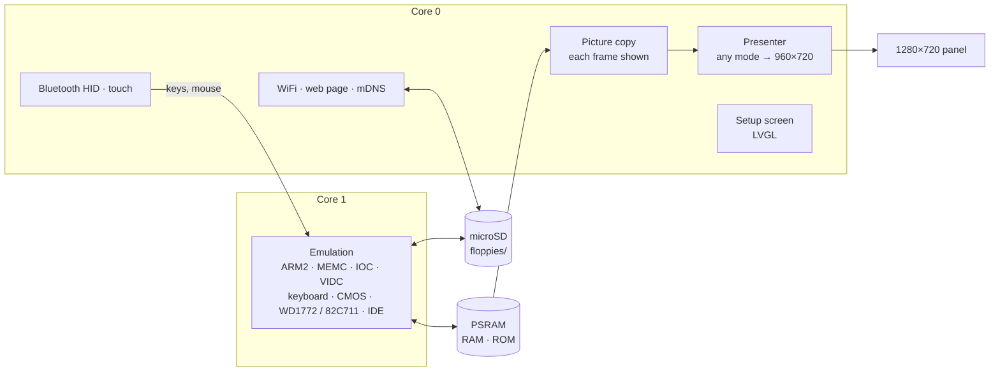

<h1 align="center">esp32arc</h1>

<p align="center">
  <b>An Acorn Archimedes on an M5Stack Tab5.</b><br>
  The A440 (ARM2 at 8 MHz) or the A3020 / A4000 (ARM250 at 12 MHz), MEMC, IOC and VIDC, up to 4 MB, Arthur 1.20, RISC OS 2.00 or RISC OS 3.11, two floppy drives and an IDE hard disc for disc images, Bluetooth keyboard and mouse, the touch screen as the mouse.
</p>

<p align="center">
  
  
  
  
  
</p>

<p align="center">
  <b>Work in progress:</b> not everything has been tested, and games and demos may or may not
  work satisfactorily.
</p>

<p align="center">
  
  
  <br>
  
  
  <br>
  <sub>RISC OS 3.11 and RISC OS 2.00 with Acorn's application discs, the Arthur 1.20 desktop,
  and Lander from the RISC OS 2 discs, from the desktop build of the same emulator
  (<code>components/archimedes/host</code>).</sub>
</p>

esp32arc turns an M5Stack Tab5 into an Acorn Archimedes, chosen on its
setup screen: the **A440**, the first generation (A305 / A310 / A440), an
**ARM2** at 8 MHz with Acorn's **MEMC**, **IOC** and **VIDC** chips, 512 KB
to 4 MB of RAM and the OS of your choice in ROM: **Arthur 1.20**,
**RISC OS 2.00** or **RISC OS 3.11**; or the **A3020 / A4000**, the next
generation, an **ARM250** at 12 MHz with a PC's floppy and IDE controller,
RISC OS 3.11 and 2 or 4 MB. Disc images on the microSD card go into two
floppy drives (and the A3020's IDE hard disc), a Bluetooth keyboard and
mouse (or your finger on the screen) work the desktop, and a setup screen
on the touch panel, and a web page on your network, handle everything
else.

It's a sibling of
[esp32ste](https://github.com/rlucencic/esp32ste) (Atari STE),
[esp32mac](https://github.com/rlucencic/esp32mac) (Macintosh Plus, SE, Classic),
[esp32mac2](https://github.com/rlucencic/esp32mac2) (Macintosh LC and II),
[esp32mac3](https://github.com/rlucencic/esp32mac3) (Macintosh LC II and LC III),
[esp32cpc](https://github.com/rlucencic/esp32cpc) (Amstrad CPC),
[esp32zx](https://github.com/rlucencic/esp32zx) (ZX Spectrum),
[esp32cbm](https://github.com/rlucencic/esp32cbm) (Commodore 64 and 128),
[esp32xl](https://github.com/rlucencic/esp32xl) (Atari 800XL and 130XE),
[esp32msx](https://github.com/rlucencic/esp32msx) (MSX1 and MSX2),
[esp32gs](https://github.com/rlucencic/esp32gs) (Apple IIGS) and
[esp32coco](https://github.com/rlucencic/esp32coco) (Tandy Color Computer 2
and 3); all are built on the shared runtime
[esp32emu](https://github.com/rlucencic/esp32emu), which also holds the
ARM2 core.

## Features

**The machine**
- **ARM2**: a new core written for this project. It has the 26-bit PC and
  PSR in R15, the four modes and their banked registers, the exceptions,
  aborts and the ARM2's own quirks, and counts the machine's memory cycles
  (sequential, non-sequential, internal, slow ROM). As the A3020's
  **ARM250** it has SWP and runs at 12 MHz. Checked against 190
  hand-written cases and hundreds of thousands of random instructions
  compared with another ARM emulator
- **MEMC1a**: the page map with its protection levels (4 to 32 KB pages),
  video, pointer and sound DMA, the ROM speed. 512 KB, 1, 2 or 4 MB of
  RAM, each wired as the MEMC addresses it, so the OS finds the size itself
- **IOC**: interrupts, the four timers, the keyboard's serial link (with
  the keyboard's own microcontroller and the mouse behind it), the I²C
  clock and CMOS RAM (PCF8583)
- **VIDC1a**: every display mode the OS sets up (1, 2, 4 and 8 bits a
  pixel, 320 to 640 pixels across, TV and monitor timings), the palette,
  the 32-pixel hardware pointer; 8-channel logarithmic stereo sound. Each
  frame is copied out of RAM while it's shown, so games that flip between
  two screens show whole frames
- **A3020 / A4000**: the 82C711 (the floppy controller with high density
  discs, the IDE interface), the IOEB (VGA timings, the monitor's ID): the
  RISC OS 3.11 desktop at 640×480
- **Arthur 1.20, RISC OS 2.00 or RISC OS 3.11**, chosen on the setup screen.
  Each keeps its own CMOS RAM; a first start begins from the OS's own
  defaults with two floppy drives configured, straight into the desktop.
  The clock is set from the internet
- **In real time** on the Tab5: the desktops and Lander (David Braben's
  1987 demo, the forerunner of Zarch) keep the Archimedes' full speed, on
  the A3020 too (Lander only just)

**Discs**
- **Two floppy drives** with a WD1772 at a real drive's pace: formatting,
  reading and writing as the OS does it
- `.adf` / `.adl` / `.img` images: ADFS E and D (800 KB), L (640 KB), M
  and S, DOS 720 KB; changed tracks are written back to the image
- **New blank discs** from the setup screen or the web page come ready
  formatted (ADFS E, 800 KB, called "Blank")
- **The A3020's IDE hard disc**: `.hdf` images; new ones of 40, 81 or
  162 MB come formatted for ADFS (as Acorn's HForm leaves them), as
  IDEDisc4 on the icon bar
- Discs changed while the machine runs are noticed, as on the real drive

**Around it**
- **Touch screen as mouse**: the pointer goes where you touch. A tap
  clicks Select, holding still for half a second clicks Menu, and moving
  while down drags with Select
- **Setup screen** before the machine starts, and any time while it runs
  (hold the top-right corner for 2 seconds): WiFi, Bluetooth pairing, the
  model, OS, memory, the mouse's Menu button, discs, reset
- **Bluetooth keyboard and mouse** (BLE HID), USB keyboards and mice on the
  Tab5's USB-A port, the Tab5 Keyboard
- **Web page** at `http://archimedes.local`: drop disc images or `.ZIP` files
  onto it, put them into drives, eject, make blank discs, and watch the
  machine (screen mode, instructions a second, free memory, sound), the
  drives, the board and Bluetooth devices live
- **Sound** on the Tab5's speaker
- **A debugger** for the programs running in it (esp32emu's: breakpoints,
  steps, registers, memory, disassembly over the network)

## Hardware

An [M5Stack Tab5](https://docs.m5stack.com/en/core/Tab5):

| | |
|---|---|
| Chip | ESP32-P4 (RISC-V, 360 MHz): 16 MB flash, 32 MB PSRAM; an ESP32-C6 for WiFi and Bluetooth |
| Screen | 5" 1280×720 MIPI-DSI, capacitive touch, held landscape |
| Storage | microSD card (FAT32 or exFAT) |
| Input | any BLE keyboard and mouse, USB keyboards and mice, the touch screen, or the Tab5 Keyboard |
| Sound | the built-in speaker (ES8388) |

Every screen mode is shown at 4:3, 960×720 in the middle of the panel,
smoothly scaled, as a monitor would.

<p align="center">
  
  <br><sub>Lander on the Tab5, captured from the panel's own picture</sub>
</p>

The Makerfabs MaTouch ESP32-S3 7", the other board of the sibling
projects, isn't supported: whether its ESP32-S3 could run an ARM2 at
speed hasn't been looked at.

## Getting started

### 1. What you need

- [ESP-IDF](https://github.com/espressif/esp-idf) v5.5 (developed with v5.5.4)
- [esp32emu](https://github.com/rlucencic/esp32emu), checked out next to this project (`../esp32emu`)
- Images of the OS ROMs, which are copyrighted and **not included**: Arthur
  1.20 and RISC OS 2.00 (512 KB each), RISC OS 3.11 or 3.10 (2 MB), as
  `roms/arthur120.rom`, `roms/riscos200.rom`, `roms/riscos311.rom` (see
  [roms/README.md](roms/README.md)). Any one of them is enough.
- A microSD card, FAT32 or exFAT, and disc images (`.adf`) of your
  software: Acorn's own application discs, games, demos

### 2. Build and flash

```sh
git clone https://github.com/rlucencic/esp32emu.git     # the shared runtime, next to it
git clone https://github.com/rlucencic/esp32arc.git && cd esp32arc
idf.py -B build-tab5 -DIDF_TARGET=esp32p4 -DSDKCONFIG=build-tab5/sdkconfig build
idf.py -B build-tab5 -DIDF_TARGET=esp32p4 -DSDKCONFIG=build-tab5/sdkconfig -p /dev/cu.usbmodem… flash   # app and the ROMs
```

Later updates only need `app-flash` instead of `flash`. Instead of flashing
the ROMs, you can also copy them into a `roms` folder on the SD card. The
Tab5 is the only target: a build for any other stops with a message.

### 3. First start

1. The board starts on the **setup screen**. Tap **WiFi** to join your
   network: the clock is set from the internet, and the web page becomes
   reachable.
2. Open `http://archimedes.local` and drop disc images onto the page, then
   choose **Insert into… → :0**. (Or copy them into the `floppies` folder
   of the SD card.)
3. Tap **Bluetooth** to pair a keyboard and mouse (optional: the touch
   screen is a mouse too).
4. Choose the **Model**, the **System** (OS) and **Memory**, then tap
   **Start**: the desktop comes up after the OS's own memory test, about
   20 seconds with RISC OS 3 and 4 MB.

<p align="center">
  
  <br><sub>The setup screen on the Tab5 while the A3020 runs RISC OS 3.11 with 4 MB (the status lines left out); the A440 offers all three OSes and 512 KB to 4 MB</sub>
</p>

## Using it

| To | Do |
|---|---|
| Get back to the setup screen | Hold the top-right corner of the screen for 2 s |
| Change the model, OS or memory | On the setup screen; **Restart** applies it |
| Click Select, Menu, Adjust | Left button; right button (or the middle one: setup screen → **Menu button**); the other one |
| ...on the touch screen | Tap for Select; hold still half a second for Menu; drag for a Select drag |
| Open a disc | Click its drive on the icon bar (:0 is the right-hand one) |
| Insert a disc | Web page: **Insert into…**, or setup screen → **Discs** |
| Make a blank disc | Web page: **New blank disk**, or setup screen → **Discs** → **New** |
| Give the A3020 a hard disc | Web page: a new blank disc of 40, 81 or 162 MB, **Insert into… → IDE disc** |
| Copy disc images from a computer | Drop them onto the web page (ZIP files are unpacked) |
| …or from the command line | `curl -T Game.adf http://archimedes.local/disks/` |
| Get a command line | F12 in the RISC OS desktop |
| Reset the CMOS RAM to the OS's defaults | Hold Delete (R on Arthur) on the keyboard while it starts again (setup screen → **Reset**) |

Disc images live in the `floppies` folder on the SD card. The inserted
discs are remembered across restarts, and so is each OS's CMOS RAM.

**Keyboard**: by position, as on the Archimedes' UK keyboard. Alt is Alt
(the Windows/⌘ keys too), Ctrl and Shift as themselves on both sides;
Backspace, Delete, Insert, Home, Page Up and Page Down as themselves; End
is Copy, Pause is Break, Print and Scroll Lock as themselves; F1-F12 and
the keypad (Num Lock, /, *, -, +, Enter; the keypad's = is its #).

## Configuration

`idf.py menuconfig` → **Emulator board**:

| Option | Default | |
|---|---|---|
| WiFi, setup screen | on | Time zone for the clock (POSIX TZ) |
| Start by itself | off | Countdown on the setup screen |
| Web page, network name | on, `archimedes` | `http://<name>.local` |
| BLE keyboard and mouse | on | Mouse speed divider |
| Sound on the speaker | on | Volume |

## How it works



- **`components/archimedes`**: the Archimedes, platform independent: the
  bus and the frame loop, MEMC, IOC, VIDC (video and sound), the keyboard,
  the CMOS clock, the floppy controllers and the A3020's 82C711 and IDE
  disc. It also builds on a desktop
  (`components/archimedes/host`) for testing with scripted keys, mouse
  and pointer, screenshots, sound recording and traces.
- **`main`**: the Archimedes on the board: memory, ROMs, settings and CMOS
  RAM, keyboard map, mouse and touch, drives and status.
- **[esp32emu](https://github.com/rlucencic/esp32emu)**: the board runtime and
  the ARM2 core (`components/arm2`).

The machine runs in frames of 20 ms of its own time, counted in ticks of
its memory clock (8 MHz, the A3020's 12 MHz). Inside a frame the ARM2 runs
up to the next event (where the display starts or ends, every few lines
of it, an IOC timer, a byte from the keyboard, the disc controller), and
the video's DMA takes its share of the bus as on the real machine. The
MEMC's page map becomes a table of 4 KB pages the CPU reads directly; only
I/O, aborts and the MEMC's own registers go through slower paths. The ARM2
core keeps its state in registers while it runs and dispatches each
instruction on its condition and kind through one table: on the Tab5 it
needs about a third of the time its first version did.

The picture a frame shows is copied out of RAM by a task on core 0 while
that frame is on the screen (a game drawing into two screens in turn
clears the one just shown as soon as the next frame starts), and the
presenter draws those copies.

The touch screen steers the real mouse: each touch becomes mouse
movements, sent over the keyboard's link as the Archimedes' mouse sends
them, until the pointer (as the VIDC draws it) is where the finger is, so
everything that reads the mouse, desktop or game, follows.

## Development

```sh
make -C components/archimedes/host                          # desktop build
components/archimedes/host/build/arc_host roms/riscos311.rom 1500 desktop.ppm 4096
ARC_FLOPPY0=Apps.adf ARC_SCRIPT=script.txt components/archimedes/host/build/arc_host roms/riscos200.rom 3000
make -C ../esp32emu/components/arm2/test test               # the ARM2 core's cases (and build/bench)

python ../esp32emu/tools/emu_console.py /dev/cu.usbmodem… lcd screen.png   # the panel's picture
python ../esp32emu/tools/emu_console.py /dev/cu.usbmodem… send "R 1 1024"  # restart: RISC OS 2.00, 1 MB
curl http://archimedes.local/api/status                                   # live status as JSON
```

The host build runs far faster than real time, and takes a script of timed
keys, typed text, mouse moves, pointer targets and screenshots
(`ARC_SCRIPT`), a CMOS RAM file (`ARC_CMOS`) and trace options. `CLAUDE.md`
has the details: the chips, the memory map and wiring, the keyboard
protocol, debugging options and the lessons learned along the way.

## Limitations

- New. On the Tab5, all three OSes start and run their desktops in real
  time on the A440, RISC OS 3.11 on the A3020; touch, floppies (reading,
  writing, blank discs), the A3020's IDE disc, the setup screen and the
  web page are checked. Not tried by hand yet: sound on the speaker, a
  Bluetooth or USB keyboard and mouse, the Tab5 Keyboard.
- **Speed**: on the A440 the desktops take 45-65% of the Tab5's emulation
  core, Lander about 90%; on the A3020 the desktop 37%, Lander all of it
  (98-100% of the real speed). Software that keeps the ARM busier still
  may run below full speed (the clock and sound stay right, the program
  slows down).
- No ARM3, MEMC2, A3000 or A5000 (which couldn't run at full speed on the
  Tab5); no ST506 hard disc on the A440, podules, serial or printer
  devices, Econet.
- Blank discs are ADFS E, which Arthur can't read: format one with
  Arthur's own `*Format` (D format) there.
- Lander plays no sound here: it asks the OS for none (whether the demo
  has any on a real machine isn't checked). The OS's own sounds (the beep,
  BASIC's SOUND) play.
- Copy-protected originals that need more than a sector image (`.adf`)
  can hold don't work: no `.apd`, `.jfd` or `.hfe` images yet.

## Credits

- [MAME](https://www.mamedev.org)'s Archimedes drivers (MEMC, IOC, VIDC1a,
  A310; by Angelo Salese, R. Belmont, Juergen Buchmueller, Sandro Ronco and
  Nigel Barnes), the reference for how the chips behave (read, not copied)
- [Arculator](https://github.com/sarah-walker-pcem/arculator) by Sarah
  Walker, the reference for the keyboard's protocol and the memory wiring
- [Unicorn](https://www.unicorn-engine.org), the ARM emulator the ARM2 core
  is tested against
- [LVGL](https://lvgl.io) for the setup screen
- [ESP-IDF](https://github.com/espressif/esp-idf) and NimBLE

## Licence

[MIT](LICENSE). LVGL (MIT) and ESP-IDF (Apache 2.0) are fetched at build
time and keep their own licences.

Acorn, Archimedes, Arthur and RISC OS are trademarks of their owners. This
project contains no Acorn code; you need your own ROM images and software.
